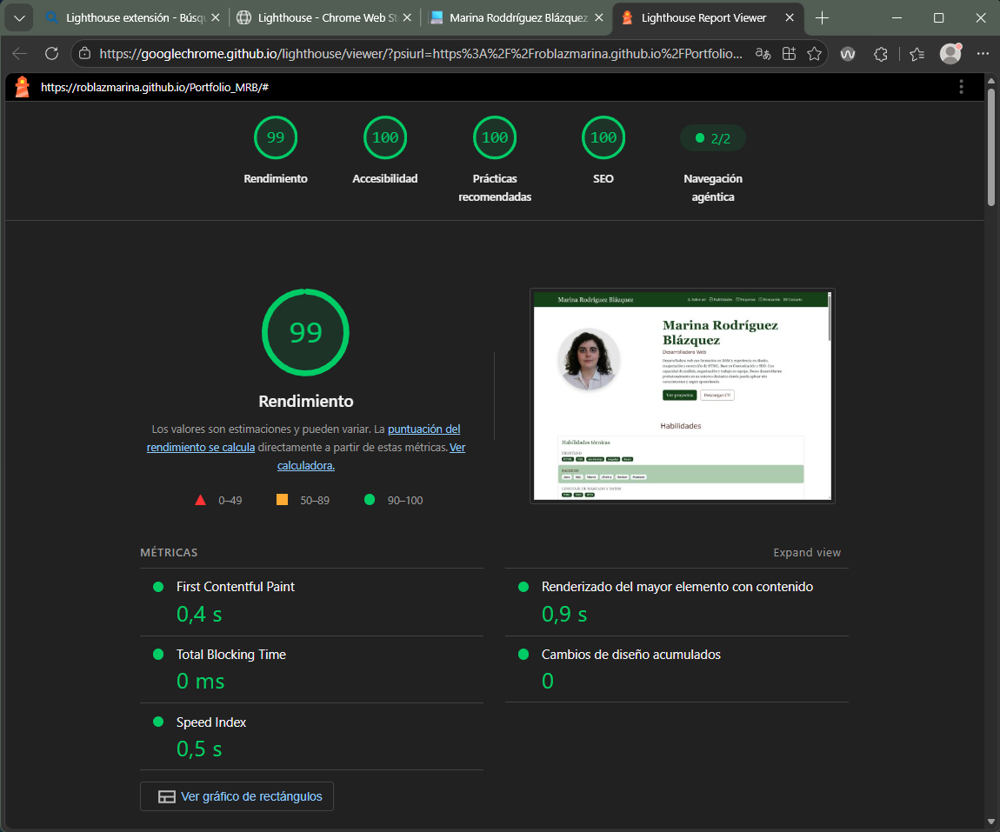
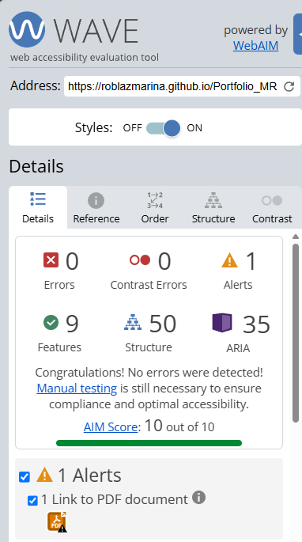
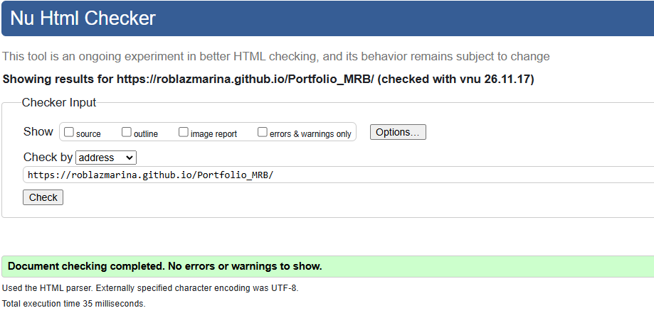
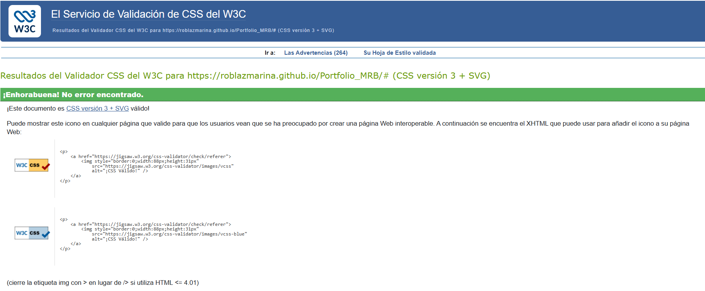

# Portfolio de Marina Rodríguez Blázquez

Portfolio profesional desarrollado con **HTML5 y Bootstrap 5.3** en el módulo
Diseño de Interfaces Web (2.º DAW).

🔗 **Web publicada:** https://roblazmarina.github.io/Portfolio_MRB/#

## Tecnologías
- HTML5 · CSS3 · Bootstrap 5.3 · Bootstrap Icons · JavaScript

## Estructura
```
index.html
css/estilos.css
js/main.js
img/    ← foto y capturas de proyectos
docs/   ← cv.pdf
```


# Portfolio profesional · Marina Rodríguez Blázquez

Portfolio web personal de desarrolladora web (DAW) con base en comunicación y SEO.
Proyecto de la Unidad 7 · Ejercicio 9.

## Web publicada

🔗 **https://roblazmarina.github.io/Portfolio_MRB/#**

Repositorio: https://github.com/RoBlazMarina/Portfolio_MRB

## Tecnologías usadas

- **HTML5** semántico.
- **CSS3** con variables de Bootstrap (`--bs-*`) y clases propias en `css/estilos.css`.
- **Bootstrap 5.3.8** (CDN): rejilla, componentes y utilidades.
- **Bootstrap Icons 1.13.1** (CDN).
- **JavaScript** (`js/main.js`): validación del formulario con Bootstrap y envío con `fetch`.
- **Formspree**: servicio que reenvía por correo los mensajes del formulario.
- **[GitHub Pages / otro]**: alojamiento.

## Estructura del proyecto

```
ej09-portfolio/
├── css/estilos.css
├── docs/
│   ├── cv.pdf
│   └── evidencias/      ← capturas del informe de calidad
├── img/
├── js/main.js
├── index.html
└── README.md
```

## Paleta de colores

| Color | Código | Uso |
|---|---|---|
| Verde bosque | `#1A471A` | Color primario: navbar, footer, botones, `h1`, enlaces |
| Burdeos | `#471A1A` | Color secundario: `h2`, botón outline, hover, bordes de campos, foco |
| Verde claro | `#B0D0B0` | Fondos suaves: cards destacadas, formulario, acordeón activo |
| Blanco | `#FFFFFF` | Fondo de página y texto sobre colores de marca |
| Gris casi negro | `#212529` | Texto del cuerpo (valor por defecto de Bootstrap) |

**Tipografías (2):** Cambria/Georgia (serif) para cuerpo y `h1`, y Verdana (sans-serif) para los `h2`.

### Ratios de contraste (WCAG 2.1 AA)

Mínimos: 4,5:1 en texto normal y 3:1 en texto grande, iconos, bordes e indicador de foco.

| Combinación | Dónde se usa | Ratio | Resultado | Captura |
|---|---|---|---|---|
| Blanco sobre `#1A471A` | Navbar, footer, botones primarios | 10,71:1 | ✅ AA | [Ver](docs/evidencias/Blanco-sobre-primario.png) |
| `#1A471A` sobre blanco | `h1`, enlaces, iconos, títulos de card | 10,71:1 | ✅ AA | [Ver](docs/evidencias/Primario-sobre-blanco.png) |
| `#471A1A` sobre blanco | `h2`, botón outline, foco, bordes de campos | 14,67:1 | ✅ AA | [Ver](docs/evidencias/Secundario-sobre-blanco.png) |
| `#471A1A` sobre `#B0D0B0` | Títulos y enlaces en cards verdes, bordes del formulario | 8,73:1 | ✅ AA | [Ver](docs/evidencias/Secundario-sobre-primario-v2.png) |
| `#1A471A` sobre `#B0D0B0` | No se usa esta combinación | 6,37:1 | ✅ AA | [Ver](docs/evidencias/Primario-sobre-primario-v2.png) |
| Blanco sobre `#471A1A` | Hover y pulsado de botones | 14,67:1 | ✅ AA | [Ver](docs/evidencias/Blanco-sobre-secundario.png) |
| `#212529` sobre blanco | Texto del cuerpo | 15,42:1 | ✅ AA | [Ver](docs/evidencias/Texto-sobre-blanco.png) |
| `#212529` sobre `#B0D0B0` | Texto del cuerpo en cards verdes | 9,17:1 | ✅ AA | [Ver](docs/evidencias/Texto-sobre-blanco.png) |
| `text-muted` (`#585C5E`) sobre blanco | Fechas | 6,76:1 | ✅ AA | [Ver](docs/evidencias/Texto-sobre-primario-v2.png) |
| `text-muted` (`#45504B`) sobre `#B0D0B0` | Fechas en cards verdes | 4,99:1 | ✅ AA | [Ver](docs/evidencias/Texto-v2-sobre-primario-v2.png) |
| Error `#842029` sobre `#B0D0B0` | Mensajes de validación | 5,62:1 | ✅ AA | [Ver](docs/evidencias/Error-sobre-primario-v2.png) |
| Error `#842029` sobre blanco | Mensajes de validación | 9,46:1 | ✅ AA | [Ver](docs/evidencias/Error-sobre-blanco.png) |
| Éxito `#0F5132` sobre `#B0D0B0` | Validación correcta | 5,56:1 | ✅ AA | [Ver](docs/evidencias/Exito-sobre-primario-v2.png) |

No hay modo oscuro, por lo que el contraste solo se comprueba en el tema claro.

## Accesibilidad

- Enlace «Saltar al contenido» al principio de la página.
- Indicador de foco propio (`:focus-visible`) en burdeos y blanco sobre fondos verdes.
- Formulario con `label` asociado, `type` y `autocomplete` adecuados, y mensajes de error.
- Imágenes con `alt` descriptivo e iconos decorativos con `aria-hidden="true"`.
- Botones solo con icono con `aria-label`.
- `prefers-reduced-motion` respetado en el desplazamiento suave y las animaciones de las cards.

## Informe de calidad

### Lighthouse

| Categoría | Puntuación |
|---|---|
| Rendimiento | 99 |
| Accesibilidad | 100 |
| Prácticas recomendadas | 100 |
| SEO | 100 |



### WAVE

Resultado: 
N.º de errores - 0
Errores de contraste - 0
Alertas quedan y por qué - 1 Alerta - Por el link al pdf, porque no sabe si tiene problemas de accesibilidad el documento o no.

Puntuación 10/10



### Validador HTML (W3C)

Resultado: 
0 errores
0 avisos



### Validador CSS (W3C Jigsaw)

Resultado:
0 errores
0 avisos



## Declaración de uso de IA

**Herramienta:** Claude

**Para qué la he usado:**
- Revisar código frente al enunciado y listar los requisitos pendientes.
- Detectar errores: erratas en clases y variables CSS, estilos en línea, detectar selector de `id` en css y cómo solventarlo, `async` ausente en el JS.
- Consultar sobre accesibilidad: enlace «Saltar al contenido», foco visible, `prefers-reduced-motion` y colores de validación con mejor contraste.
- Calcular los ratios de contraste de la paleta.
- Explicar cómo conectar el formulario con Formspree y escribir el código de envío con `fetch`.
- Explicar cómo funciona el accordion y la apertura de nuevas pestañas con los enlaces.
- Estructuración del README.md y formato para la tabla de contrastes.

**Qué he decidido yo:** La paleta y las tipografías, el diseño de la página, el contenido, los textos y la estructura. POr ejemplo, en la revisón que realicé con la IA, aunque me pidió cambiarlo, mantuve el estilo del botón de la Pokédex y el nombre largo de la navbar con `text-wrap` porque me se adhería al estilo y diseño que me había planteado desde un principio.

**Por qué:** He usado la IA como una segunda opinión para revisar si cumplía todos los puntos del enunciado, para entender los criterios de accesibilidad y aprender cómo integrar elementos como el accordion, no para generar la web de cero. Esta web sigue siendo bastante fiel al borrador que hice de base en papel.
